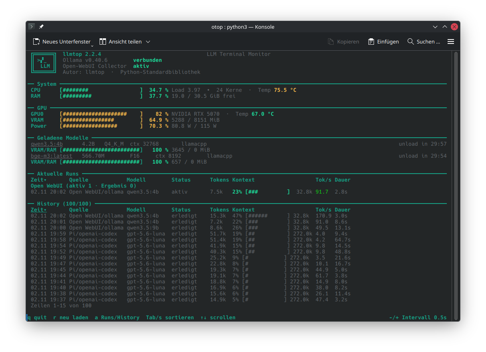

<div align="center">
  
  <p><strong>Terminal-Monitor für Ollama</strong> mit CPU-, RAM-, GPU-, VRAM- und Run-Metriken.</p>
  <p>
    <a href="#start">Schnellstart</a> ·
    <a href="#angezeigte-werte">Messwerte</a> ·
    <a href="#open-webui-adapter">Open WebUI</a> ·
    <a href="#pi-adapter">Pi-Adapter</a>
  </p>
</div>



> **Version 2.3.35** · Python-Terminal-Anwendung aus der Standardbibliothek.
> llmtop liest den Ollama-Status und lokale System-Sensoren direkt aus und
> zeigt laufende sowie abgeschlossene Modell-Runs datensparsam im Terminal.

Die Version wird im TUI-Kopf, in der ersten Zeile von `--once` und über
`--version` angezeigt. Die maßgebliche Versionsnummer steht in `VERSION` in
`llmtop.py`; die vollständige Historie befindet sich in `version.md`.

## Dateien

| Datei | Inhalt |
|-------|--------|
| `llmtop.py` | Programmeinstieg, CLI und Snapshot-Modus |
| `llmtop_sources.py` | Ollama-, CPU-, RAM- und GPU-Datenerfassung |
| `llmtop_metrics.py` | Run-Schema, JSONL-Historie, Collector und Open-WebUI-Integration |
| `llmtop_tui.py` | curses-Rendering und TUI-Hintergrundsampler |
| `README.md` | diese Anleitung |
| `status.md` | Projektstand, bekannte Grenzen und Prüfhinweise |
| `version.md` | Versionsschema, Versionsanzeige, Changelog |
| `pi/llmtop_run_metrics.ts` | optionaler globaler Pi-Adapter für lokale und Cloud-Provider |
| `assets/llmtop-logo.svg` | Projektlogo im aktuellen TUI-Stil |
| `assets/llmtop-screenshot.png` | Beispielansicht der TUI |
| `.gitignore` | lokale Python-Artefakte und Backups ausschließen |
| `plan/` | akzeptierte Arbeitspläne (Plan-Mode-Artefakte) |

## Versionierung

Das Projekt ist als Git-Repository eingerichtet. Der aktuelle Branch ist
`master`. Code, Dokumentation und akzeptierte
Pläne werden gemeinsam versioniert. Vor einem Commit: Tests aus `status.md`
ausführen, `VERSION` sowie `README.md`, `status.md` und `version.md` abgleichen.
Tags verwenden das Format `vX.Y.Z`.

## Umstieg 2.0

Dies ist ein harter Namenswechsel: Der Start erfolgt ausschließlich über
`python3 llmtop.py`; die früheren `otop.py`-Dateien, `OTOP_*`-Variablen und
`$XDG_STATE_HOME/otop/` werden nicht mehr verwendet. Die neuen Pfade und
Variablen beginnen mit `llmtop` beziehungsweise `LLMTOP_`. Nach dem Umstieg
muss der Open-WebUI-Adapter einmal mit
`python3 llmtop.py --install-open-webui-adapter` neu installiert werden.

## Start

```bash
python3 llmtop.py                      # Vollbild-TUI (curses), Refresh alle 0,5 s
python3 llmtop.py --interval 1         # TUI mit 1 s Refresh
python3 llmtop.py --once               # ein Einzel-Snapshot (Skripte / kein Terminal)
python3 llmtop.py --host http://127.0.0.1:11434
python3 llmtop.py --chat '{"model":"qwen3.5:4b","messages":[{"role":"user","content":"Hallo"}]}'
python3 llmtop.py --collector          # Loopback und privates Open-WebUI-Docker-Gateway
python3 llmtop.py --install-open-webui-adapter  # Filter per Open-WebUI-API installieren
python3 llmtop.py --emit event.json    # Schema-2-Testevent an den Collector senden
python3 llmtop.py --no-nvidia          # nvidia-smi überspringen (sysfs-Pfad)
python3 llmtop.py --debug               # Diagnose-Logging aktivieren
python3 llmtop.py --log-file llmtop.log # Diagnosemeldungen in Datei schreiben
python3 llmtop.py --chat @request.json --energy-rapl-sudo  # CPU-RAPL mit sudo-cached lesen
python3 llmtop.py --version            # Versionsnummer, danach Exit 0 (kein TUI)
```

`$OLLAMA_HOST` wird als Default übernommen; `--host` ohne Protokoll wird zu
`http://<host>`. Für einen optionalen, ausschließlich lesenden Open-WebUI-
Datenbank-Fallback kann `LLMTOP_OPEN_WEBUI_DB` auf einen zugänglichen Pfad zu
`webui.db` gesetzt werden. Ohne stabile Zuordnung werden keine Daten ergänzt.

| Option | Verhalten |
|--------|-----------|
| `--host` | Ollama-URL; Default `$OLLAMA_HOST`, sonst `http://localhost:11434` |
| `--interval` | Refresh-Sekunden im TUI; Default 0,5 s, **auf 0,2–60 s begrenzt** (`--interval 0.1` → 0,2 s) |
| `--once` | ein Snapshot, kein Vollbild; ignoriert `--interval` (CPU-Messung 1 s) |
| `--no-nvidia` | `nvidia-smi` nicht aufrufen, sysfs benutzen |
| `--debug` | detaillierte Diagnosemeldungen aktivieren; im TUI-Modus standardmäßig nach `$XDG_STATE_HOME/llmtop/llmtop.log` schreiben |
| `--log-file DATEI` | Diagnosemeldungen in die angegebene Datei schreiben; private Datei mit 1 MiB/3 Rotationen |
| `--energy-rapl-sudo` | bei `--chat`/`--generate` CPU-RAPL über eine vorhandene nicht-interaktive sudo-Anmeldung lesen |
| `--chat JSON` | direkter Streaming-Aufruf an `/api/chat`, Abschlussmetriken und verfügbare Komponentenenergie lokal speichern |
| `--generate JSON` | direkter Streaming-Aufruf an `/api/generate`, Abschlussmetriken und verfügbare Komponentenenergie lokal speichern |
| `--collector` | lokalen, token-geschützten Collector für `POST /v1/runs` starten |
| `--collector-bind` / `--collector-port` | Listen-Adresse und Port; Default bleibt `127.0.0.1:11435` |
| `--emit DATEI` | Schema-2-Event aus Datei oder `-` für stdin an den Collector senden |
| `--install-open-webui-adapter` | Filter per Open-WebUI-Admin-API installieren, konfigurieren und global aktivieren |
| `--version` | Versionsnummer ausgeben und beenden |

## Exit-Codes

| Fall | Code |
|------|------|
| normal (`--once`, TUI mit `q`) | 0 |
| kein TTY (Vollbild ohne Terminal) | 1, Hinweis auf `--once` auf stderr |

## Tasten im TUI

| Taste | Wirkung |
|-------|---------|
| `q` / `Q` | beenden |
| `r` / `R` | Programm mit denselben Optionen neu laden |
| `x` / `X` | sudo-Passwortabfrage für CPU-Power öffnen |
| `h` / `H` | Help ein/aus mit Bedienungs- und Sensorquellenübersicht |
| `-` | Intervall halbieren (min. 0,2 s) |
| `+` / `=` | Intervall verdoppeln (max. 60 s) |
| `Tab` / `Shift-Tab` | nächste / vorherige Sortierspalte der Run-History |
| `s` / `S` | Sortierrichtung der Run-History umschalten |
| `a` / `A` | Fokus zwischen aktuellen Runs und Run-History wechseln |
| `c` / `C` | Run-History nach Sicherheitsabfrage leeren |
| `Enter` / `Leertaste` | markierte History-Gruppe auf- oder zuklappen |
| `←` / `→` | markierte History-Gruppe zu- oder aufklappen |
| `↑` / `↓`, `Bild↑` / `Bild↓` | Cursor im fokussierten Bereich bewegen |
| `Pos1` / `Ende` | ersten/letzten sichtbaren History-Eintrag markieren |

## TUI-Layout

Ein vierzeiliger Kopfbereich zeigt ein optisch quadratisches Terminal-Logo mit
Prompt und LLM-Kennung; zwei Zeichen trennen Logo und Produkttext. Ollama-,
Open-WebUI-Collector- und Pi-Adapter-Status folgen rechts davon. Die
rechtsbündige Statusleiste enthält das Intervall und die Legende `-/+`.
Navigationstext ist gedimmt grau, Steuersymbole bleiben Cyan. Eine Leerzeile trennt ihn von den Messwerten. Die
Vollbildansicht
gliedert sich danach von oben nach unten in **System**, **GPU**,
**Geladene Modelle**, **Aktuelle Runs** und **History**. Bereichslinien beginnen am linken Rand und laufen
vor sowie nach dem Titel; alle übrigen Inhalte haben einen Leerzeichen-Rand
links. Bei 40×18 verwendet sie eine kompakte Ansicht mit
Kernwerten, Modellanzahl und History-Status, damit sich keine Bereiche
überzeichnen.
CPU, RAM, GPU-Auslastung, VRAM und Power verwenden
pro Terminal dieselbe Balkenbreite; Label, Prozentwert und Detailwert sind
spaltenweise ausgerichtet. Die Farbsyntax ist global: Struktur (Überschriften,
Labels und Rahmen) ist Cyan, Auslastungsstatus wechselt bei unter 30 % von
Grün zu Amber (30–59 %), Orange (60–90 %) und Rot über 90 %;
Temperaturstatus verwendet weiterhin Grün/Gelb/Rot. Auf 256-Farbterminals
sind Amber und Orange getrennte Farbtöne; mit 8 Standardfarben werden sie
über die Darstellung unterschieden. Sekundärinfos sind gedimmt.
Balkenklammern sind außerhalb der History immer normal dargestelltes Cyan;
Kontextzellen in der History bleiben statusgrau; die aktive Cursorzeile bleibt
durchgehend hervorgehoben. History-Gruppen verwenden neutrales Grau ohne
Fettdarstellung; die aktive Cursorzeile erhält schwarze Schrift auf Cyan,
ebenfalls ohne Fettdarstellung, damit Schwarz nicht zu Hellgrau aufgehellt wird. Im
Ollama-Speicherbalken bedeuten die Farben explizit
den Offload-Grad der GPU/VRAM-Anzeige: Grün oberhalb 55 %, Gelb bei 45–55 %
und Rot unterhalb 45 % GPU-Anteil. CPU/RAM bleibt gedimmt grau. Beide Anteile
nutzen `#` und zeigen zusätzlich Textwerte. Eine
Leerzeile trennt System, GPU, geladene Modelle, aktuelle Runs und History.
**Aktuelle Runs** und **History** verwenden dieselben Spalten und Werte für
Zeit, Quelle, Modell, Status, Tokens, Kontext, Tok/s und Dauer. Die Breite jeder
sichtbaren Spalte richtet sich dynamisch nach Überschrift und Inhalt; aktuelle
Runs und History nutzen dabei dieselben Spaltenbreiten. Die History berücksichtigt
dafür stets ihre gesamte Liste. Die Kontextspalte der aktuellen Runs zeigt den Fortschritt zuerst als farbigen
Balken, danach den rechtsbündigen Prozentwert und nur das graue Kontextlimit;
in der History bleibt die Kontextzelle statusgrau und übernimmt bei der aktiven
Zeile weiterhin die durchgehende Cursor-Hervorhebung. **History** zeigt
eine scrollbare Tabelle mit bis zu 500 abgeschlossenen instrumentierten Runs.
Sie kann nach Abschlusszeit, Quelle, Modell, Status, Tokens, Kontextverbrauch,
Ausgaberate und Dauer sortiert werden. Die aktive Sortierspalte ist im
Tabellenkopf exakt über die Länge ihres Textes unterstrichen und mit `▾`
beziehungsweise `▴` markiert; die History-Überschrift bleibt frei von
Sortierdetails. Eine Leerzeile trennt die History von der Statusleiste. Die
History gruppiert Pi-Runs nach `session_id` und Open-WebUI-Runs vorrangig nach
`chat_id`; Session und Nachricht dienen dort nur als Fallback. Ohne diese IDs
bleibt jeder Run einzeln. Gruppen sind zunächst eingeklappt. Ihre Tabellenzeile
zeigt ausschließlich die Ergebniswerte des neuesten abgeschlossenen Runs sowie
dessen Ausgaberate; Quelle, Kurzkennung, Modell, Status und letzter Abschluss
bleiben ebenfalls sichtbar. Bei Pi-Sessions und Open-WebUI-Chats wird dafür der
erste ID-Block ohne die Präfixe `Session` beziehungsweise `Chat` angezeigt. Die
Quellenspalte erhält bei knapper Breite bevorzugt ihren vollständigen Inhalt;
der zweistellige Aufklappmarker wird dabei mitgerechnet. Fehlende Werte werden nur aus demselben
Run eindeutig abgeleitet; unbekannte Werte bleiben `n/a`. Mit dem Cursor lässt sich die
Gruppe aufklappen und zeigt dann alle einzelnen Runs. Die Persistenz und die
Begrenzung auf 500 Runs bleiben unverändert. Mit `c` wird ausschließlich die
Run-History atomar geleert; aktuelle Runs und System-Snapshots bleiben erhalten.
Kontext wird nach dem prozentualen Verbrauch sortiert, nicht nach der absoluten
Tokengröße. Die Kontextspalte zeigt Prozentwert, Fortschrittsbalken und danach
nur das Limit im Format `[######      ] 42% 16.4k`; fehlende Providerwerte
bleiben `n/a`. Die Daten bleiben
als begrenzte JSONL-Datei gespeichert; eine Datenbank ist bei 500 Einträgen
nicht nötig. Zusätzlich speichert llmtop lokale, begrenzte System-Snapshots. Der
Snapshot-Pfad kann über `LLMTOP_HISTORY_FILE`, die Run-Historie über
`LLMTOP_RUN_HISTORY_FILE` oder `XDG_STATE_HOME` angepasst werden. Im TUI-Modus werden System-Snapshots aus Rücksicht auf I/O höchstens alle fünf Sekunden persistiert; die Live-Anzeige aktualisiert sich weiterhin mit dem eingestellten Intervall. `--once` schreibt sofort einen Snapshot.

## Angezeigte Werte

* **History**: Gruppen aus derselben Pi-Session beziehungsweise demselben
  Open-WebUI-Chat werden kompakt dargestellt. Pi-Session-Gruppen verwenden
  dieselbe Aufklappfunktion wie Chats. Die Gruppenzeile repräsentiert den
  neuesten abgeschlossenen Run; fehlende Werte werden nur eindeutig aus diesem
  Run abgeleitet. Open WebUI verwendet `chat_id` vor der Browser-`session_id`,
  damit unterschiedliche Chats nicht gemeinsam gruppiert werden. Aufgeklappte
  Gruppen zeigen alle enthaltenen Runs in der bestehenden Tabelle.
  Bei diesen Unterzeilen stehen **Zeit** und **Quelle** eingerückt; das Zeitfeld
  erhält zwei Leerzeichen innerhalb seiner eigenen Spalte, die Quelle bleibt
  zusätzlich um den zweistelligen Gruppenmarker eingerückt. Alle übrigen
  Spaltenbreiten und Abstände bleiben unverändert.
* **Kopfbereich**: vierzeiliges, optisch quadratisches Terminal-Logo mit
  Prompt und LLM-Kennung sowie zwei freien Spalten zum Textblock. **LLM Terminal
  Monitor** ist stets mittig in der ersten Zeile platziert; `llmtop <VERSION>`
  und Produktname,
  `Ollama v<VERSION>` mit Erreichbarkeit (`/api/version`), **Open-WebUI
  Collector**-Status sowie **Pi Adapter**-Status (`aktiv` / `nicht aktiv`). Eine Leerzeile
  folgt vor den Messwerten. Rechts unten steht `-/+ Intervall <SEKUNDEN>` als
  Anzeige und Legende. Namen und Metadaten sind
  gedimmt grau; verbundene/aktive Stati sind Grün und OFFLINE/nicht aktive
  Stati Rot. Bei 40 Spalten werden die Verbindungsstati als `Ollama OK/OFF` und
  `OW Collector OK/OFF` verdichtet.
* **Aktuelle Runs**: Pi und Open WebUI senden auf getrennten Collector-Pfaden (`/v1/runs/pi`, `/v1/runs/open-webui`) mit demselben Bearer-Token. Quelle und Provider (etwa `Pi/OpenAI`, `Pi/Ollama`, `Open WebUI/Ollama`), Status, Modell, Session-/Chat-/Message-IDs und verfügbare Token-/Dauerwerte bleiben getrennt. Aktive Runs beider Quellen stehen vor frischen Ergebnissen; gleichartige Identitätsblöcke zeigen jeweils `aktiv N · Ergebnis N`, ohne eine Quelle oder Identität vorzuziehen. Ein Abschluss bleibt höchstens zehn Sekunden sichtbar und wird danach atomar aus `run.jsonl` entfernt, bleibt aber in der begrenzten Run-History erhalten. Bei mehr Runs als sichtbaren Zeilen ist der Bereich mit `a` und den Scrolltasten erreichbar. Verwaiste nicht-finale Live-Einträge werden nach 90 Sekunden ohne Lebenszeichen entfernt und nicht als aktuelle Runs angezeigt. Lange Streams senden regelmäßig Lebenszeichen. Schema-1-Daten bleiben als `Legacy` lesbar. Status, Modell, Kontextlimit und grafischer Kontextverbrauch (Prompt- plus Ausgabetoken),
  Prompt-/Ausgabe-/Gesamttoken und Ausgabe-Rate. `--chat` und `--generate`
  instrumentieren eigene direkte Ollama-Aufrufe ohne Reverse Proxy. Während
  des Streamings liefert Ollama keine Tokenwerte; bis zum Abschluss stehen sie
  daher als `n/a` da. Ohne Ereignis wird nichts geschätzt. Direkte lokale Runs speichern
  zusätzlich verfügbare Komponentenenergie aus CPU-RAPL, AMD-sysfs und NVIDIA-
  `nvidia-smi`; die Quellen werden getrennt ausgewiesen und bei möglicher
  Überlappung nicht zu einer Gesamtsumme addiert. Eine Steckdosenmessung ist
  nicht enthalten. In breiten TUI-Tabellen wird zusätzlich eine `Wh`-Spalte
  für Open-WebUI-Runs angezeigt; Gruppenzeilen summieren die Energiewerte ihrer
  enthaltenen Runs. Andere Quellen bleiben in dieser ersten Anzeige leer.
* **Geladene Modelle** (`/api/ps`): Name, Parametergröße, Quantisierung,
  `context_length`, Runner, Restzeit bis Auto-Unload (`expires_at`),
  `size_vram` / `size` → Aufteilung GPU % / CPU %. Der Ollama-Bereich ist in
  „Aktuelle Runs“ und „Geladene Modelle“ unterteilt.
* **CPU**: Bereinigter Modellname aus `/proc/cpuinfo` ohne integrierte
  Radeon-Zusatzbezeichnung, Gesamt-% aus `/proc/stat`-Differenz zwischen zwei
  Refreshes, dazu nutzbare logische Kernanzahl und Temperatur
  aus hwmon oder generischen Thermal-Zones (`k10temp`, `coretemp`, `zenpower`,
  `x86_pkg_temp`, `cpu_thermal`, `acpitz`), sofern verfügbar.
* **CPU-Power**: CPU-Package-/SoC-Leistung aus dynamisch erkannten
  powercap-/RAPL-Zonen, CPU-hwmon oder optional TUXEDO Control Center über
  D-Bus. Die erste RAPL-Messung bleibt bis zum zweiten Zählerstand `n/a`;
  Quelle und echte Leistungsgrenze werden angezeigt. GPU-hwmon wird nicht als
  CPU-Power verwendet. Wenn RAPL nur für root lesbar ist, aktiviert `x`/`X` in
  der TUI nach einer sichtbaren `sudo -v`-Abfrage einen begrenzten RAPL-Helper,
  ohne llmtop neu zu starten. CPU-Power-Wert und Balken werden auch ohne
  Leistungsgrenze sichtbar farbig hervorgehoben. Die Systemzeile heißt
  `Power`; bei echter Leistungsgrenze wechseln Balken und Wert dynamisch
  zwischen Grün (unter 30 %), Amber (30–59 %), Orange (60–90 %) und
  Rot (über 90 %). Ohne Grenze bleibt ein gültiger Messwert grün
  und erhält eine reine 65-W-Darstellungsskala für den Balken; dies ist keine
  Leistungsgrenze und wird nicht als Prozentwert angezeigt.
* **RAM**: Auslastung `%`, Größe `GiB`, Zeile nach den CPU-Systemwerten. Primär
  `/proc/meminfo`; bei einer endlichen cgroup-v1/v2-Grenze werden effektiver
  Verbrauch und verfügbares Limit des Prozesses angezeigt.
* **GPU**: Alle erkannten DRM-GPUs werden zusammengeführt und in TUI sowie
  `--once` durch sichtbare Trennzeilen voneinander abgegrenzt. Modellnamen
  werden aus `product_name` oder der lokalen PCI-ID-Datenbank ermittelt;
  NVIDIA verwendet
  bevorzugt `nvidia-smi` und ordnet die Werte über die PCI-Bus-ID zu; AMD nutzt
  amdgpu-sysfs, Intel i915/xe bekannte GT-Auslastungsdateien. Temperatur,
  VRAM und Power kommen ergänzend aus der zugeordneten hwmon-Schnittstelle.
  Fehlende Einzelwerte bleiben `n/a`; dadurch werden auch GPUs ohne
  Auslastungsdatei angezeigt. Intel nutzt zusätzlich verfügbare generische
  GT-/Busy-sysfs-Dateien; fehlen diese, bleibt die Auslastung bewusst `n/a`.
  `--no-nvidia` überspringt ausschließlich
  `nvidia-smi` und verwendet weiterhin sysfs. Der gemessene Wattwert bleibt
  auch ohne Leistungsgrenze sichtbar. Der Balken verwendet dann eine reine
  115-W-Darstellungsskala; eine Power-Prozentanzeige gibt es nur bei gemeldeter
  echter Leistungsgrenze.
* **VRAM**: VRAM-Auslastung `%` und Größe in MiB
  (`VRAM [##########  ] 96.5 %  7864 / 8151 MiB`). Im Ollama-Bereich zeigt ein
  geteilter Balken die Modellaufteilung als „VRAM/RAM“: Der Modellname ist
  grau und unterstrichen; die folgenden Modellinformationen beginnen an einer
  verkürzten festen Tabulatorposition. Auch Quelle, Modell, Status und Metriken aktueller
  Runs sind per Tabulator ausgerichtet. Label und Klammern sind Cyan. VRAM ist oberhalb 55 % Grün,
  bei 45–55 % Gelb und darunter Rot. Der VRAM-Prozentwert steht auf derselben Flucht wie die Prozentwerte von System
  und GPU. Der CPU/RAM-Anteil bleibt ausschließlich als grauer Balkenanteil und
  in der gedimmten Größenangabe im Format `MiB / MiB` mit einmaliger Einheit sichtbar; ein zweiter
  RAM-Prozentwert wird nicht angezeigt.
  Der Kontextbalken aktueller Runs steht ausschließlich in der Kontextspalte.
  Prozentwert und Balken sind statusabhängig farbig; Verbrauch und Limit bleiben
  gedimmt grau. Tok/s aktueller Runs ist rot unter
  10, gelb von 10 bis unter 50 und grün ab 50 Tok/s; diese Tok/s-Farbe ist
  nicht fett.

## Open-WebUI-Adapter

Der Filter liegt in `open_webui/llmtop_run_metrics.py` und wird ausschließlich über die Open-WebUI-API installiert. Er überträgt über den eigenen Collector-Pfad verifizierte Modellprovider neutral; fehlende finale Usage bleibt sichtbar als `n/a`. Der TUI-Start aktualisiert auch bereits aktive ältere Filterversionen. Die lokale `.env` benötigt zusätzlich zu `LLMTOP_COLLECTOR_TOKEN` einen Admin-API-Key:

```dotenv
OPEN_WEBUI_URL=http://127.0.0.1:3000
OPEN_WEBUI_API_KEY=<Open-WebUI-Admin-API-Key>
```

Beim normalen TUI-Start prüft llmtop bei vorhandenem `OPEN_WEBUI_API_KEY` und
`LLMTOP_COLLECTOR_TOKEN` asynchron, ob der globale aktive Filter
`llmtop_run_metrics` installiert ist. Alte globale Adapter wie
`otop_run_metrics` werden dabei deaktiviert, damit ein Request nicht doppelt
registriert wird. Fehlt oder deaktiviert der Filter, wird ersatzweise die
bestehende Installationsroutine ausgeführt. Ohne vollständige
lokale Konfiguration und bei API-Fehlern bleibt der Start unverändert; `--once`
und die Skriptmodi führen keine Adapter-Änderung aus.

Danach genügt der normale TUI-Start; der Collector wird bei konfiguriertem
`LLMTOP_COLLECTOR_TOKEN` automatisch im Hintergrund gestartet:

```bash
python3 llmtop.py
python3 llmtop.py --install-open-webui-adapter
```

`--collector` bleibt für einen separat laufenden, blockierenden Dienstmodus
verfügbar.

Der Installationsbefehl erkennt die private Docker-Gateway-Adresse, setzt die Filter-Valves, aktiviert den Filter und schaltet ihn global. Der Filter überträgt ausschließlich Quelle, Provider, UUID, Session-/Chat-/Message-IDs, Modell, Zeit- und Nutzungswerte. Collector-Fehler werden abgefangen und beeinflussen die Chatantwort nicht. Die gleiche Schema-2-Schnittstelle verarbeitet auch den optionalen Pi-Adapter; der Kern benötigt dafür keine Pi-Abhängigkeit.

## Pi-Adapter

Der dependency-freie Adapter unter `pi/llmtop_run_metrics.ts` wird beim normalen TUI-Start automatisch nach `~/.pi/agent/extensions/` aktualisiert. Nach einem Update muss eine bereits laufende llmtop-TUI einmal mit `r` neu geladen werden, damit ihr Collector die getrennten Adapterpfade übernimmt. Dabei legt llmtop die Collector-URL und den Token ausschließlich mit Dateimodus `0600` unter `$XDG_STATE_HOME/llmtop/pi-collector.json` (Fallback `~/.local/state/llmtop/`) ab; neue Pi-Prozesse lesen diese private Laufzeitdatei automatisch. Für bereits laufende Pi-Prozesse einmal `/reload` ausführen oder Pi neu starten.

Er fasst alle Modell- und Tool-Folgeturns einer bearbeiteten Pi-Anfrage zu einem Live-Run zusammen. Die aktuelle Session-ID wird beim Pi-Session-Start zwischengespeichert und jedem Run mitgegeben; mehrere Ergebnisse derselben Pi-Session erscheinen dadurch als aufklappbare Gruppe. Die eingeklappte Gruppe zeigt den neuesten abgeschlossenen Run; erst wenn Pi den Agentenlauf als erledigt meldet, wird genau ein Datensatz für dessen finale Antwort in der Run-History gespeichert. Dabei werden Input-/Cache-/Ausgabetoken, Kontextlimit, Gesamtdauer und Ausgaberate übertragen. Der Session-Kontext wird während aktiver Runs aus Pi gelesen und höchstens einmal pro Sekunde als Tokenzahl aktualisiert; bekannte Provider-Usage ergänzt diese Werte. Die Session-ID wird direkt aus dem Pi-Session-Manager übernommen und bei älteren Laufzeitobjekten aus Header oder Sessiondatei ermittelt. Unvollständige Zwischenmeldungen mit `0` überschreiben bereits bekannte Tokenstände nicht. Steht weder Session-Kontext noch Usage bereit, bleiben Tokenwerte bis dahin `n/a`. Er sendet ausschließlich Quelle, Provider, Session-ID, Modell, UUID, Zeit und Nutzungsmetriken. Prompt, Antwort, Tooldaten, Sessionpfade und Credentials bleiben lokal in Pi.

## Bekannte Grenzen

* Die Ollama-API selbst liefert **keine** CPU-/GPU-Auslastung (nur `size_vram`);
  `/metrics` gibt es hier nicht (404). GPU-Auslastung kommt vom **Host**, sie ist
  geräte-global und nicht exklusiv Ollama zurechenbar.
* Ollama läuft im Docker-Container; die GPU-Messung erfolgt am Host (NVIDIA-Binary
  `nvidia-smi` bzw. sysfs), nicht im Container.
* Der Collector lauscht standardmäßig auf `127.0.0.1:11435` und zusätzlich auf dem erkannten privaten Docker-Gateway von `open-webui`. Er benötigt `LLMTOP_COLLECTOR_TOKEN`; `.env.example` zeigt die lokalen Variablennamen.
* Run-Historien speichern nur IDs, Quelle, Modell, Status, Zeit- und Tokenzähler
  sowie optional Kontexttoken, Kontextlimit und Identitätsfelder (`session_id`,
  `chat_id`, `message_id`); keine Prompts oder Modellantworten. Die
  Identitätsfelder dienen der quelleninternen Gruppierung und Wiedererkennung;
  bei fehlenden IDs werden Runs nicht spekulativ zusammengelegt. Das
  Kontextlimit wird bevorzugt aus dem Run (`options.num_ctx`) übernommen und
  ersatzweise aus dem aktuell geladenen Modell in `/api/ps` ergänzt. Open-WebUI
  liefert bei Ollama-Streaming echte Usage-Werte häufig erst im Abschluss;
  währenddessen zeigt llmtop deshalb einen eindeutigen Wartezustand statt Schätzungen.
* CPU-% ist ein Differenzwert über ein Refresh-Intervall — der erste Frame zeigt
  „Messung“.
* GPU-Sensoren sind treiber- und kernelabhängig. NVIDIA-Werte werden bei
  verfügbarer PCI-Bus-ID mit DRM/sysfs zusammengeführt; ohne passende ID kann
  ein sehr alter NVIDIA-Treiber nur über die Geräte-Reihenfolge zugeordnet
  werden. Nicht verfügbare Einzelwerte erscheinen als `n/a`.
* Schlägt `/api/ps` fehl, zeigt die Anwendung den Fehler statt „kein Modell geladen“.
* Modelle ohne Scrollen: Passen nicht alle vollständigen Modellkarten in den
  verfügbaren Bereich, zeigt die TUI ihre Anzahl als ausgeblendet an; es gibt
  keinen Scroll-Modus.
* TUI braucht ein echtes Terminal (TTY). Ohne TTY: `--once` verwenden.
* Mindest-Terminalgröße 40×18. Darunter zeigt die TUI einen Hinweis, damit
  Fußzeile oder Bereiche nicht überdeckt werden.

## Testumgebung (live)

Ollama 0.40.6 im Docker-Container unter `http://localhost:11434`, GPU NVIDIA
RTX 5070 Laptop (8151 MiB) + AMD iGPU (`card1`), 24 Kerne, Python 3.12.
Aktueller Prüfstatus und bekannte Grenzen: siehe `status.md`.
